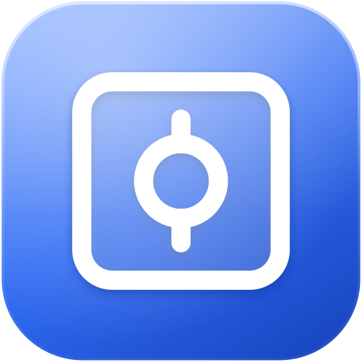
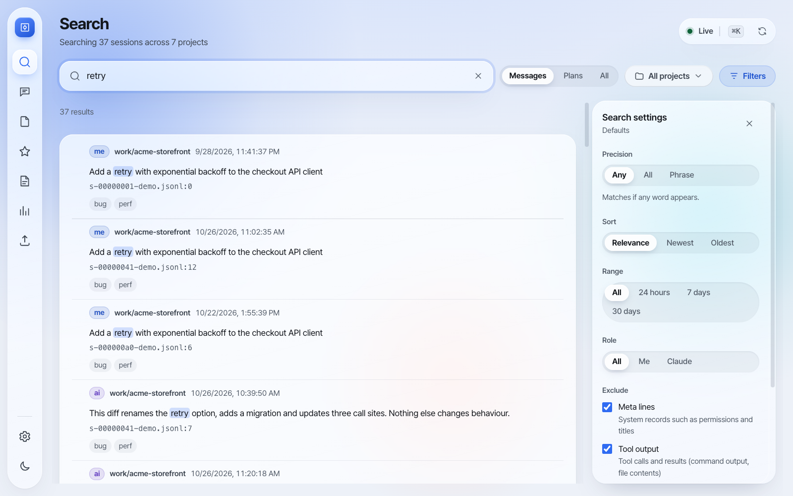
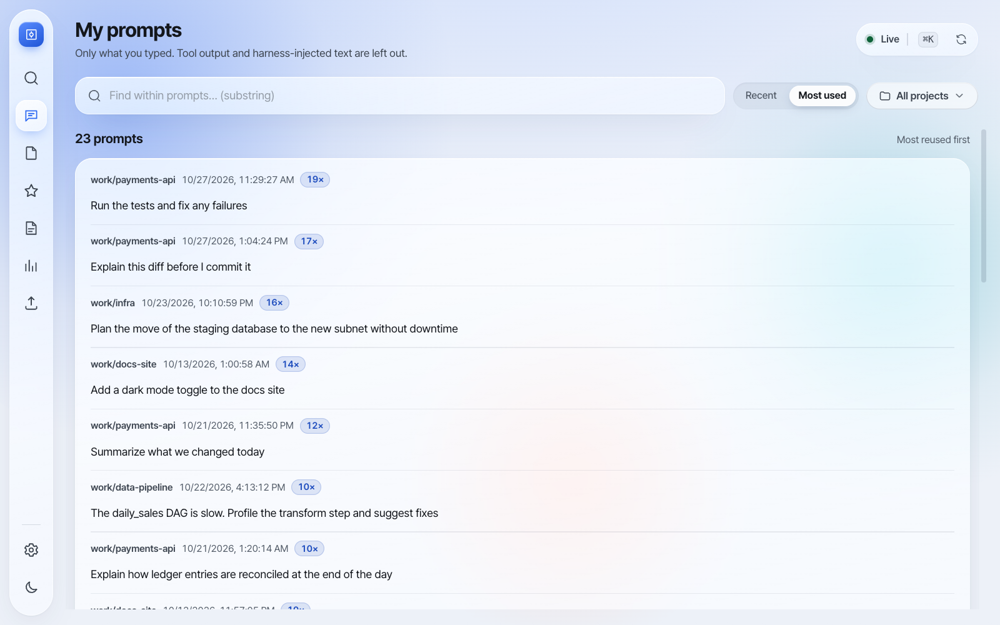
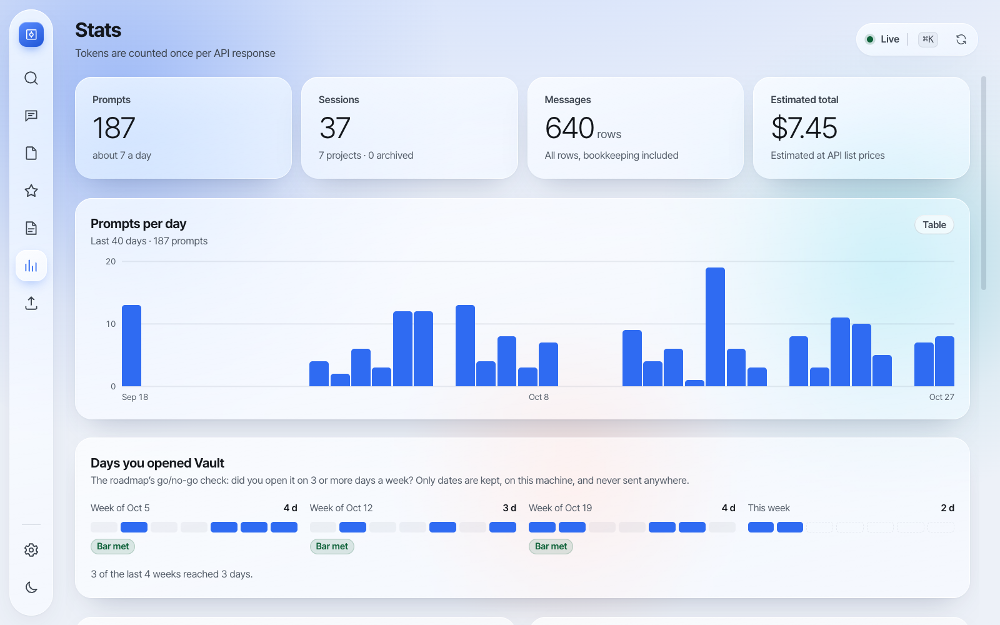
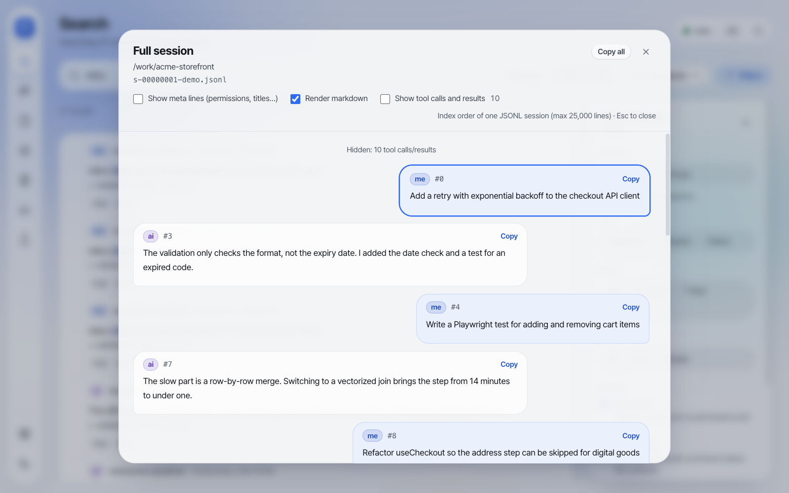
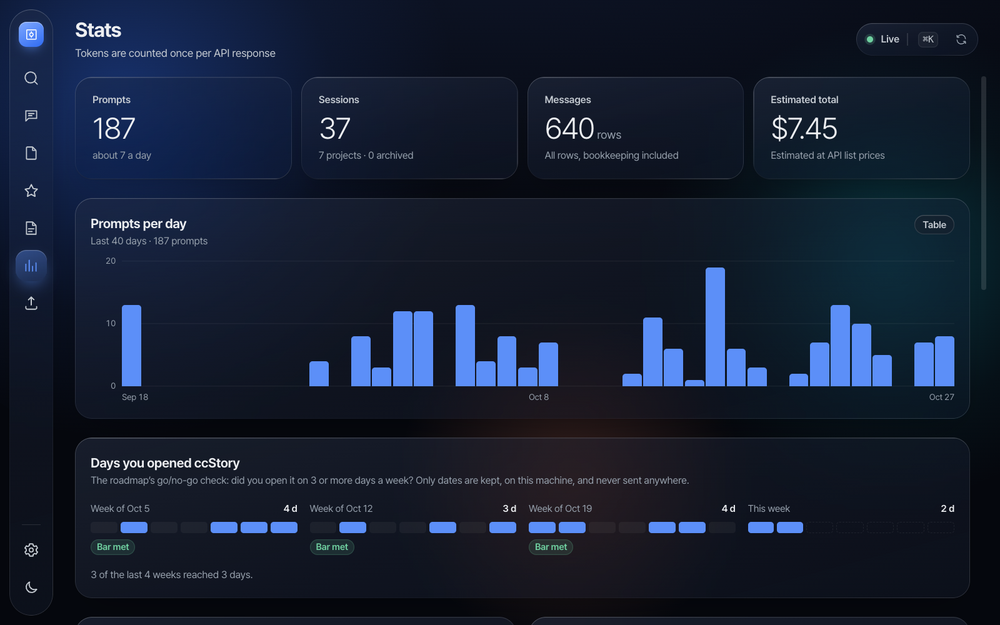

<p align="center"></p>

# Trove

[English](README.md) · [한국어](README.ko.md) · **日本語** · [简体中文](README.zh-CN.md)

> このドキュメントは英語版 [README](README.md) の翻訳です。内容に差がある場合は英語版が正となります。

**Trove** は、[Claude Code](https://www.anthropic.com/claude-code) の会話履歴を自分のマシン上で保管・検索するデスクトップアプリです。

- 会話をインデックスし、Claude Code が古いトランスクリプトを削除した後もコピーを残します。
- すべての履歴をミリ秒単位で検索でき（SQLite FTS5）、自分が書いたプロンプトを探して再利用できます。
- 旧名は *Claude Vault*、次に *ccStory* でした。Anthropic のガイドラインでは他社の製品名に「Claude」を使えないため改名しました。Trove はその連想もなくした名前です。

[](https://github.com/RosieOh/trove/releases)
[](https://github.com/RosieOh/trove/actions/workflows/ci.yml)
[](LICENSE)

**[macOS（Apple Silicon / Intel）・Windows・Linux 版をダウンロード →](https://github.com/RosieOh/trove/releases)**

<picture>
  <source media="(prefers-color-scheme: dark)" srcset="docs/images/search-dark.png">
  
</picture>

- **プライバシー**
  - Claude のファイルは読み取りのみです。`~/.claude/` の下には何も書き込みません。
  - インデックスとバックアップは、ユーザーデータフォルダ内のローカル SQLite DB に保存されます。
  - Trove が本当に役立っているかを測るため、アプリを開いた*日付*だけ（時刻や内容は含みません）を同じ DB に記録し、統計タブに表示します。外部には何も送信しません。
  - ネットワーク通信は、GitHub Releases に新しいバージョンがあるかを確認するアップデートチェックだけです。会話データは送信せず、**設定** でオフにできます（[ADR-0005](docs/decisions/0005-update-check-network-exception.md)）。
- **対応プラットフォーム:** 主な対象は macOS（Apple Silicon、Intel）です。Windows と Linux のビルドも CI で同じ E2E テストに通っていますが、日常的な利用実績はまだ少なめです。
- **アプリの表示言語:** 現在は韓国語と英語のみです（日本語 UI はまだありません）。
- **ライセンス:** MIT。[LICENSE](LICENSE) を参照してください。

## インストール

[Releases](https://github.com/RosieOh/trove/releases) からお使いのシステム用のファイルをダウンロードしてください。まだ**コード署名されていない**ため、初回起動時に確認が一度必要です。

**macOS:** `Trove-<バージョン>-mac-arm64.dmg`（Apple Silicon）または `…-mac-x64.dmg`（Intel）。

1. DMG を開き、**Trove** をアプリケーションフォルダにドラッグします。
2. 一度起動すると、macOS が開発元を確認できないと表示します。**完了** をクリックします。
3. **システム設定 → プライバシーとセキュリティ** を開き、「"Trove" はブロックされました」の横にある **このまま開く** をクリックします。macOS 14 以前では、アプリを右クリックして **開く** を選んでください。
4. ターミナルを使う場合は `xattr -dr com.apple.quarantine "/Applications/Trove.app"` でもかまいません。

署名のない macOS ビルドは自動アップデートできません。新しいバージョンは Releases ページから入手してください。

**Windows:** `Trove-<バージョン>-win-x64.exe` を実行します。SmartScreen に「Windows によって PC が保護されました」と表示されたら、**詳細情報 → 実行** を選んでください。現在のユーザーにインストールされます。

**Linux:** どちらかのパッケージを使ってください。
- AppImage: `chmod +x Trove-*.AppImage && ./Trove-*.AppImage`
- Debian/Ubuntu: `sudo apt install ./Trove-*.deb`

**初回起動時:**
- Trove は `~/.claude/projects` と `~/.claude/plans` を読み込みます。Codex CLI を使っている場合は `~/.codex/sessions` も読み込みます。
- インデックスはバックグラウンドスレッドで作成されるため、ウィンドウは固まりません。5 GB の履歴で約 1 分かかり、その後は新しく追加された行だけを読みます。
- 別の場所を読ませるには、`CLAUDE_HOME` / `CODEX_HOME` に絶対パスを指定します。

## スクリーンショット

| マイプロンプト：自分で入力したものだけ、よく使う順 | 統計：API レスポンスごとに一度だけ数えたトークン、コスト、Trove を開いた日 |
|---|---|
|  |  |
| **セッション全体**：会話をすべて表示、ツール出力は折りたたみ | **ダークテーマ** |
|  |  |

スクリーンショットは架空のデモ履歴（`scripts/demo-corpus.mjs`）で撮影しています。`npx vite build && node scripts/screenshots.mjs` で再生成できます。

## 機能

| 領域 | 状態 |
|------|------|
| `~/.claude/projects`（ルートの `{uuid}.jsonl`、`subagents/`、`agent-transcripts/`、`sessions-index.json`）と `~/.claude/plans` のインデックス | 対応 — 追記分のみ読み込み、バックグラウンドワーカー |
| **アーカイブ**：Claude Code が削除したセッションも検索可能（「Archived」と表示）。削除は明示的な操作のみ | 対応（既定でオン） |
| 全文検索 + プロジェクト・ロール・期間・メタ・サブエージェント・**ツール出力**・**タグ** フィルター | 対応 |
| 検索モード（OR / AND / フレーズ）、並び替え（関連度 / 新しい順 / 古い順）、語の途中や CJK は部分一致で再検索 | 対応 |
| **マイプロンプト**：自分で入力したものだけ、重複を除外、最近順またはよく使う順 | 対応 |
| **ファイル**：どのセッションがいつ、どのブランチでそのファイルに触れたか | 対応 |
| 再インデックスやアップグレードでも消えないお気に入りとタグ | 対応 |
| セッションのトランスクリプト表示（Markdown、メタ・ツールの表示切り替え、アーカイブ通知） | 対応 |
| `{{変数}}` を使えるプロンプトテンプレート | 対応 |
| コマンドパレット（⌘/Ctrl+K）、キーボードでの結果移動 | 対応 |
| 統計：週ごとに Trove を開いた日数（ロードマップの継続判断の指標） | 対応 |
| モデル別の使用量を **API レスポンスごとに一度だけ** 集計。5 分・1 時間のキャッシュ書き込みを反映したコスト見積もりと、基準日つきで編集できる料金表（Claude と、Codex が使う OpenAI モデル） | 対応 |
| Markdown / CSV エクスポート — コピーまたはファイルに保存 | 対応 |
| **バックアップ**：毎日の DB スナップショットに加え、アップグレード・アーカイブ削除・復元の直前にも作成。設定から復元。開けない DB は最新のバックアップから自動復旧 | 対応（3 件保持） |
| 設定：アーカイブ方式、バックアップ、アップデートチェック、データの場所、全件の再読み込み | 対応 |
| Codex CLI セッション（`~/.codex/sessions`、作業ディレクトリごとにまとめる） | ベストエフォート |
| 韓国語 / 英語 UI、ライト / ダークテーマ | 対応 |

## ドキュメント

[docs/](docs/README.md) ディレクトリを参照してください（PRD、アーキテクチャ、ADR、ロードマップ、リリース手順）。ドキュメントは英語です。

[CHANGELOG.md](CHANGELOG.md) — バージョンごとの変更点。

## 開発

```bash
npm install
npm run dev
```

開発中に DevTools を自動で開くには、次のようにします。Chromium が無害なログをターミナルに少し出力します。

```bash
VAULT_OPEN_DEVTOOLS=1 npm run dev
```

それ以外の場合は **表示 → 開発者ツール** メニューか、macOS では **⌥⌘I** で開けます。VS Code のターミナルやエージェントから実行するときは、先に `ELECTRON_RUN_AS_NODE` を解除してください（`env -u ELECTRON_RUN_AS_NODE npm run dev`）。

その他のスクリプト:

- `npm run build` — 型チェック、Vite の本番ビルド、`electron-builder` でインストーラーを作成
- `npm run typecheck` — main/preload/shared とレンダラーの型チェック
- `npm run lint` — ESLint（flat config）
- `npm test` — 単体テスト（パーサー、検索ヘルパー、料金計算、IPC 入力チェック）
- `npm run test:db` — SQLite 統合テスト（インデックス、アーカイブ、マイグレーション、検索、バックアップ）
- `npm run test:e2e` — E2E スモークテスト。ビルドしたアプリ（先に `npx vite build`）をフィクスチャのトランスクリプトで起動し、Playwright で操作します
- `npm run bench -- <vault.db>` — 既存のインデックスで検索レイテンシを測定
- `npm run poc` — トランスクリプトを走査してパーサー統計を出す CLI（GUI・DB なし）

環境変数: `CLAUDE_HOME`、`CODEX_HOME`（絶対パス）、`VAULT_USER_DATA`（インデックス DB を捨ててよい場所に置く）、`VAULT_DISABLE_UPDATER=1`。

CI（GitHub Actions）は push と PR ごとに次を実行します。
- 型チェック、lint、単体テスト、DB 統合テスト、レンダラーのビルド
- macOS・Windows・Linux での E2E スモークテスト

## コントリビュート

[CONTRIBUTING.md](CONTRIBUTING.md) をお読みください。バグ報告やアイデアは **GitHub Issues** へ、長く残す決定は `docs/decisions/` か [docs/issue-decisions.md](docs/issue-decisions.md) に記録します。

## 免責事項

Trove は独立したオープンソースツールです。
- Anthropic とは提携関係になく、Anthropic の承認も受けていません。「Claude」と「Claude Code」は Anthropic の商標であり、ここではこのアプリが何と一緒に使うものかを説明するためにのみ使っています。
- アプリは、Claude Code がすでにあなたのマシンに保存しているファイルだけを読み込みます。業務用リポジトリをインデックスする際は、所属組織のセキュリティポリシーに従ってください。
- コストは、記録されたトークン数とユーザーが編集できる料金表から計算した見積もりです。実際の請求額ではありません。
