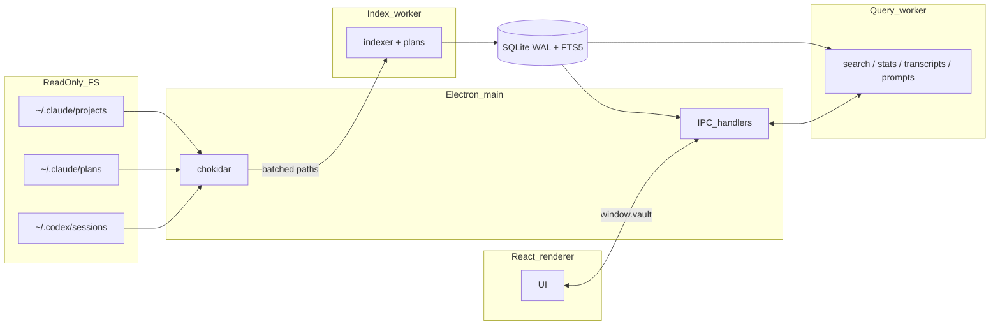

# Architecture

## High-level flow

## Processes and threads

- **Main**: window, IPC handlers, file watcher, schema migration, and light DB work only
  (lookups by id, user-data writes, export). See [ADR-0007](decisions/0007-worker-threads.md).
- **Index worker** (`electron/indexWorker.ts`): the only writer of index tables. Full scans
  on startup / "재인덱싱", plus file events forwarded from the watcher. DB snapshots
  (`VACUUM INTO`) run here too, queued with scans.
- **Query worker** (`electron/queryWorker.ts`): a `query_only` connection serving search,
  stats, transcripts, prompts and the files view — every query that can take hundreds of
  milliseconds on a large corpus.
- **Preload**: exposes a narrow `window.vault` API via `contextBridge`.
- **Renderer**: React + Tailwind; Fuse.js may reorder the current hit list in *relevance*
  sort only, and never drops a hit.

Security defaults: `contextIsolation: true`, `nodeIntegration: false`, `sandbox: true`,
CSP `connect-src 'none'` in production, navigation and permission requests denied.

## Paths

- **Claude home**: default `~/.claude`. Override the parent directory with an **absolute**
  `CLAUDE_HOME` (both `projects` and `plans` resolve under it). Codex: `CODEX_HOME` or
  `~/.codex`.
- **The app never writes under `~/.claude/`** — not even `mkdir`. A source root that does
  not exist yet is polled every 30 s and watched once it appears. Exports chosen under
  `~/.claude` are refused.
- **Claude data (read-only)**: under `~/.claude/projects/{slug}/` every `*.jsonl` up to
  depth 8 (root `{uuid}.jsonl`, `{uuid}/subagents/*.jsonl`, legacy `agent-transcripts/`),
  plus `sessions-index.json` entries; `originalPath` is the display title.
- **Codex (read-only)**: rollout files under `~/.codex/sessions/YYYY/MM/DD/`, grouped into
  projects by the `cwd` in each file's first `session_meta` record.
- **Plans (read-only)**: `~/.claude/plans/**/*.md` (depth 8) → `plan_files`.
- **App database**: `app.getPath('userData')/vault.db` (WAL). `VAULT_USER_DATA` (absolute)
  overrides the folder — used by end-to-end runs so the real profile is untouched.
- **Backups**: `userData/backups/vault-<UTC yyyymmdd-hhmmss>-<reason>.db`; see Backups.

## Indexing

See [ADR-0006](decisions/0006-stable-keys-append-indexing-archive.md).

- Files are read in 4 MB chunks (`electron/lineReader.ts`); lines are split on the `\n`
  byte. Rows are written in transactions of 2,000 lines; the worker yields between them.
- **Append-only resume.** `sessions` stores `indexed_bytes` and SHA-1 fingerprints of the
  first 4 KB and of the 256 bytes before the offset. If both still match, only new bytes
  are parsed and existing rows (and ids) are untouched. Otherwise the file is re-read from
  0, keeping the session id. A trailing line without `\n` that is not valid JSON yet is
  left for the next event.
- **Stable keys.** `messages.msg_key` = line `uuid` (Codex `payload.id`), else `file#line`.
- **Archive.** When a source file disappears the session gets `archived_at` (setting
  `archiveMode = keep`, the default) or is deleted (`mirror`). Reconciliation is skipped
  for an adapter whose root is missing. Purging archived rows is an explicit action.
- **Live updates.** chokidar v4 watches the roots (globs were removed in v4), filters
  `.jsonl` / `.md`, and the main process forwards batched events every 300 ms.
- **Adapters** (`electron/adapters.ts`) provide `listProjects`, `listSessions`,
  `projectForFile`, `createParser` and whether the format is `appendable` (Codex is
  stateful — model and cwd are announced once — so its files are re-read on change).

## JSONL parsing

`shared/jsonlParse.ts` (Claude Code) and `shared/codexParse.ts` (Codex) both produce
`ParsedLine`: role, body text, content kinds, `messageClass` (`dialog` | `meta` | `other`),
timestamp, model, usage (incl. the 1-hour cache-write subset), sidechain flag, file paths
touched by tool calls, cwd/branch, `uuid`, response identity (`message.id` + `requestId`),
and `isPrompt` / `promptText`.

Rules worth knowing:

- Only top-level types `user`, `assistant`, `system` (or untyped legacy lines) are
  conversation. Every other typed line is bookkeeping (`meta`) **even if it carries a
  `message`** — `api-request-blob` stores copies of internal API requests. Bookkeeping
  never contributes usage.
- `isMeta: true` user lines (skill bodies, caveats) are `meta`.
- Tool results arrive as `user` messages; they are re-attributed to role `tool`.
- **Prompts** are user text lines that are not sidechain, not `isMeta`, and not
  harness-written (`<task-notification>`, interruptions, continuation summaries, local
  command output…). IDE context blocks are stripped; slash commands render as
  `/name args`, shell inputs as `!cmd`.

Run `npm run poc` to see how your own corpus classifies.

| Kind | Handling |
|------|-----------|
| `text` | Concatenate `text` fields |
| `tool_use` | `[도구] name · description` + one line per input field (still searchable) |
| `tool_result` | Result text with `<system-reminder>` and harness notes stripped |
| `thinking` | `[thinking] …`; thinking-only lines are `meta` |
| `string` | Top-level string content |
| `invalid_json` | Raw preview only |

## SQLite schema (v9, summary)

Index tables (derived, rebuildable except archived sessions):

- `projects` — one row per source project; `tool`, `archived_at`.
- `sessions` — one row per transcript file; `indexed_bytes`, `size_bytes`, `head_hash`,
  `tail_hash`, `file_mtime_ms`, `message_count`, `archived_at`.
- `messages` — one row per non-blank line: body, kinds, class, timestamp, model, token
  columns (`input_tokens`, `output_tokens`, `cache_read_tokens`, `cache_creation_tokens`,
  `cache_creation_1h_tokens`), `msg_key`, `api_msg_id`, `request_id`, `is_prompt`,
  `prompt_text`, cwd, branch, sidechain.
- `messages_fts` — FTS5 external content over the **`messages_searchable` view**
  (non-`meta` rows only), kept in sync by conditional triggers. `rebuild` and
  `integrity-check` work against the view.
- `file_refs` — paths touched by tool calls (Files tab).
- `plan_files` + `plan_files_fts`.

User data (never derivable — never dropped by a migration):

- `favorites` — `msg_key` + snapshot (body, role, project, session file) + `created_at`.
- `tags`, `message_tags` (`msg_key`, `tag_id`).
- `templates`.
- `model_prices` — per-model USD/MTok incl. `cache_write_1h_per_mtok`; seeded from
  `shared/pricing.ts`, user edits win (see Cost estimation).
- `meta` — `schema_version`, `prices_seed_version`, settings as `setting.*`
  (`archiveMode`, `autoUpdate`, `backupKeep`).

**Migrations.** From v9 on, a migration must never drop `sessions`/`messages`; to force a
re-parse, call `requestFullReparse` (resets `indexed_bytes`). The v≤8 → v9 migration moved
favorites/tags to stable keys by re-reading the referenced lines, then rebuilt the index
tables. Before any migration the old file is copied to the backup folder. Document every
bump here.

## Backups

`electron/backup.ts`, [ADR-0010](decisions/0010-vault-db-backups.md). In Keep mode the DB
is the only copy of deleted transcripts, so it is snapshotted:

| When | How | Where it runs |
|------|-----|---------------|
| Daily (after the first scan, then checked hourly) | `VACUUM INTO` `.tmp` → rename | index worker |
| "Back up now" | same | index worker |
| Before a schema migration | file copy (clone on APFS) before any connection opens | main, at startup |
| Before "Delete all archived" (purge refused if it fails) | `VACUUM INTO` | index worker |
| Before a restore | rename of the live file | main, all connections closed |

The newest `backupKeep` (0 / 1 / **3** / 7) are kept. 0 stops automatic snapshots without
deleting any. Snapshots are skipped below 1.2× the DB size of free space.
`openVaultDbWithRecovery` quarantines a DB that will not open (`vault.db.corrupt-<time>`)
and installs the newest backup that passes `verifyBackup`: `quick_check`, a vault schema
no newer than `SCHEMA_VERSION`. Only when no backup passes is an empty DB created; either
way a dialog says what happened. Restore verifies first, then closes every connection,
swaps the files and relaunches the app.

## Search

- Primary: FTS5 over conversation rows. `buildFtsQuery(raw, matchMode)` supports `any`
  (OR prefix tokens), `all` (AND), `phrase`; `"quoted groups"` are exact phrases.
- **Substring fallback**: when the token query finds nothing or is malformed, an escaped
  `LIKE '%…%'` scan runs (infix matches such as "색인" in "재색인" — see
  [ADR-0008](decisions/0008-fts-tokenizer.md)).
- Filters: project, role, date range (`ts_ms`), exclude meta (default on; when off, meta
  rows are added via a LIKE scan since they are not in FTS), exclude subagents, exclude
  tool output, **tag** (an empty query + tag lists everything with that tag).
- **Latest wins.** `QueryService.search` keeps one search running and at most one
  waiting; a newer request replaces the waiting one, which resolves to `null`. The
  renderer also ignores any response that is not from its newest request.
- Hits carry `msgKey`, `tagIds`, `isFavorite`, `archived`, and a body clamped to 2,000
  chars (`bodyTruncated`; copy/template fetch the full text via `messageBody`).
- Plans: separate FTS; `scope: 'all'` returns message hits then plan hits for relevance
  sort (BM25 scales differ) and interleaves by time for time sorts. Project or tag filters
  exclude plans.

## Prompts view

`listPrompts` groups `is_prompt` rows by exact `prompt_text`, counts uses as distinct
`msg_key`s (forked sessions copy lines with the same uuid), and returns the latest
occurrence for open/favorite/tag. Substring filter; recent or most-used order.

## Cost estimation

Token usage is counted **once per API response**: Claude Code writes one line per content
block and repeats `usage` on each (later lines carry the final `output_tokens`), so stats
group by `(api_msg_id, request_id)` and take each field's maximum. On a real corpus naive
line sums were 2.16× too high.

`shared/pricing.ts` prices the result:

- **Seeded, not baked in.** `DEFAULT_PRICES` is dated by `PRICES_AS_OF` and shown in the
  editor; user rows always win. `PRICES_SEED_VERSION` adds newly published models once
  without touching existing rows.
- Cache reads use each model's own rate; cache writes are split into 5-minute (1.25×
  input) and 1-hour (2× input) using `cache_creation_1h_tokens`.
- **Unpriced models are excluded, not zeroed**, and listed by name. Zero-token models
  (`<synthetic>`) are dropped first.
- Model ids match by longest prefix; Haiku 5.5's >100K-prompt tier is not modeled.

## Localization

`shared/i18n.ts` holds a typed dictionary; `ko` is the source of truth and a key missing
from `en` is a type error. `src/i18n.tsx` provides `I18nProvider` / `useT`, persists the
choice (`vault-locale`). Main-process dialogs use `app.getLocale()`. Parser labels stored in
the DB (`[도구]`, `[대기열] …`) are not translated.

## IPC contract

`shared/ipc.ts` lists channels and DTOs; main implements them; preload exposes
`window.vault.*`. All renderer input is normalized in `electron/ipcGuards.ts`. Main ↔
worker messages are typed in `electron/workerProtocol.ts`.

## Renderer layout

`src/App.tsx` is the shell (rail, page header, search screen and its filter panel).
Screens live in `src/tabs/` (Prompts, Files, Favorites, Templates, Stats, Export,
Settings), modals and the tag editor in `src/components/`, shell primitives (rail,
header, project picker, toast, segmented control, icons) in `src/ui.tsx`, formatting
helpers in `src/format.ts`. The visual system — tokens and glass component classes — is
`src/index.css`, mapped into Tailwind by `tailwind.config.js` ([ADR-0009](decisions/0009-glass-visual-system.md)).
`public/theme-init.js` sets the theme before first paint.

## Testing

- `npm test` — unit tests (parser, Codex parser, search helpers, pricing, IPC guards).
- `npm run test:db` — SQLite integration tests in `tests/db/` (append indexing, partial
  lines, re-read with favorites, archive vs mirror, missing-root guard, usage dedupe, FTS
  integrity, prompts, v8 migration). `better-sqlite3` ships N-API prebuilds, so they run
  under plain Node with the same binary the app loads in Electron.

## Packaging

`electron-builder`; `better-sqlite3` is unpacked from asar (`**/*.node`). The two workers
and shared chunks are emitted as `dist-electron/*.cjs`.
